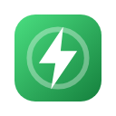
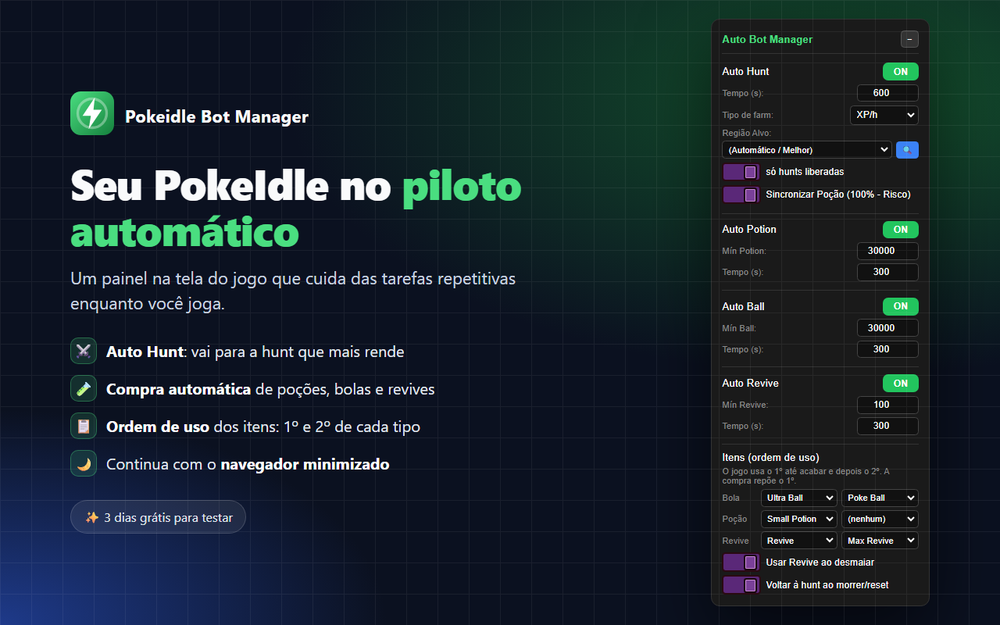
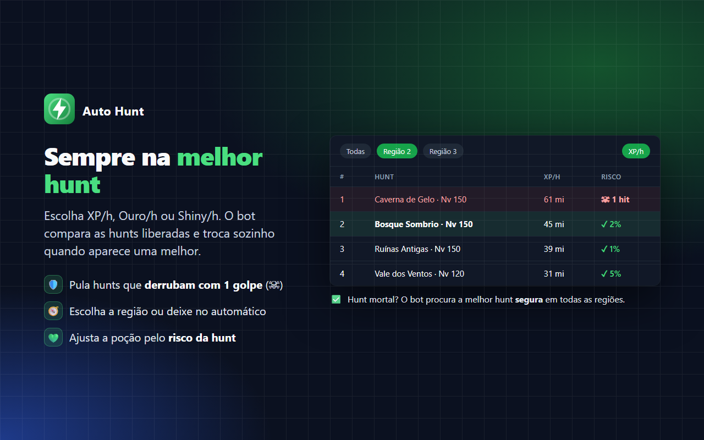
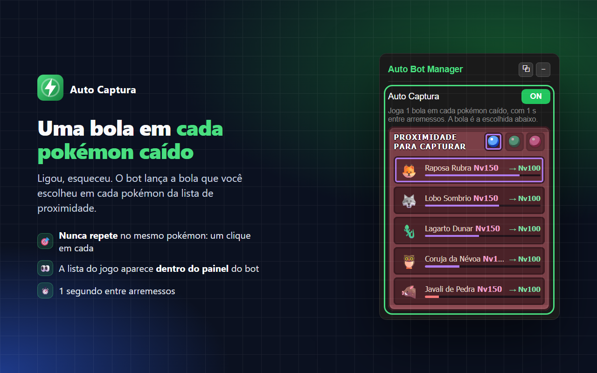
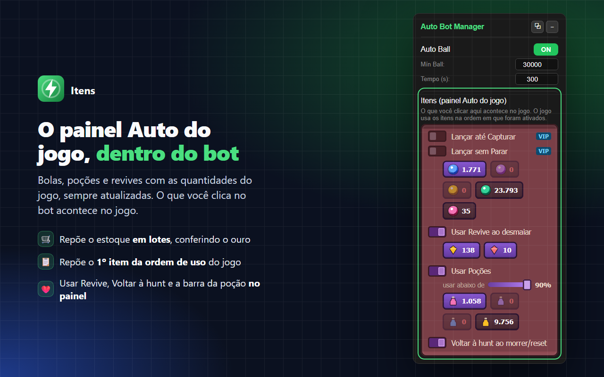
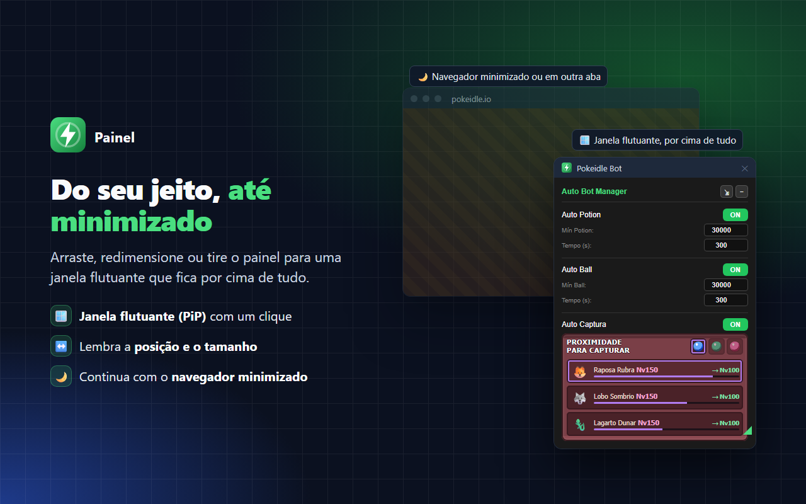
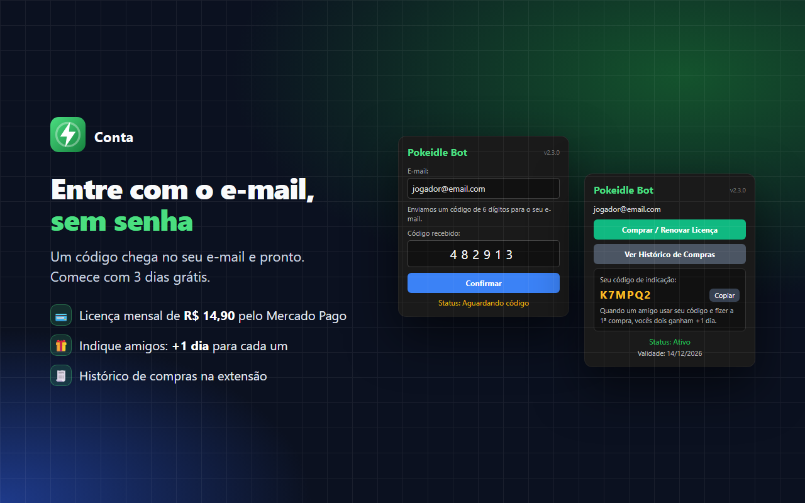

# Pokeidle Bot Manager

**Automação para o PokeIdle: Auto Hunt, Auto Captura, compra automática de poções, bolas e revives e painel em janela flutuante.**

---

## ✨ Funcionalidades

### ⚔️ Auto Hunt
- Vai sozinho para a hunt que mais rende, por **XP/h**, **Ouro/h** ou **Shiny/h**.
- Escolha uma região ou deixe no automático.
- **Proteção contra hunts mortais:** se a melhor hunt da região derruba o pokémon com 1 golpe (☠), o bot procura a melhor hunt segura em todas as regiões. Se nenhuma for segura, ele fica onde está.
- Ajusta a barra de uso das poções pelo risco da hunt: arredonda o risco para cima e usa a poção abaixo de *100% − risco*. De 50% de risco para cima, mantém a vida sempre cheia.

### 🧪 Compra automática de itens
- **Auto Potion**, **Auto Ball** e **Auto Revive** mantêm o estoque acima do mínimo que você definir.
- Compra em lotes de até 9.999 unidades, conferindo o ouro antes e confirmando cada compra.

### 🎯 Auto Captura
- Joga **1 bola em cada pokémon caído**, com a bola escolhida no jogo.
- **Nunca repete** no mesmo pokémon: cada um recebe um único clique.
- A lista **Proximidade para Capturar** aparece dentro do painel do bot, igual à do jogo.

### 📋 Itens: o painel Auto do jogo dentro do bot
- Bolas, poções e revives com as **imagens e quantidades do jogo**, sempre atualizadas.
- Tudo que você clica no bot acontece no jogo: ligar itens, "Usar Revive ao desmaiar", "Voltar à hunt ao morrer" e a barra de uso da poção.
- O jogo usa os itens na ordem em que foram ativados, e a compra automática repõe o 1º dessa ordem.

### 🪟 Painel do seu jeito
- **Arraste** pelo título e **redimensione** pelo canto. O painel lembra a posição e o tamanho; duplo clique no título volta ao padrão.
- **Janela flutuante (⧉):** o painel sai para uma janela PiP, que fica por cima de outros programas.

### 🌙 Funciona com o navegador minimizado
Com a aba oculta (outra aba selecionada ou janela minimizada), o Chrome desacelera os timers da página para 1 vez por minuto. O bot usa um relógio próprio, num Web Worker, e continua no ritmo normal.

> 💡 Para o Chrome não descartar a aba do jogo, adicione `pokeidle.io` em **Configurações → Desempenho → Sempre manter estes sites ativos**.

### 🔐 Conta e licença
- Entrada com **código enviado por e-mail**, sem senha.
- **3 dias grátis** para testar; depois, licença mensal de **R$ 14,90** pelo Mercado Pago.
- **Indique amigos:** na 1ª compra de quem usar o seu código, vocês dois ganham **+1 dia**.
- Histórico de compras dentro da extensão.

---

## ⚠️ Requisito do Auto Hunt

O Auto Hunt usa o ranking de hunts da extensão gratuita **/hunt for PokeIdle**:

Se ela não estiver instalada, o popup da extensão e o painel do bot mostram um aviso com um botão para instalar. As compras automáticas e a ordem dos itens funcionam sem ela.

---

## 📦 Instalação

### Pela Chrome Web Store (recomendado)
Clique em um dos botões do topo. Funciona no **Chrome, Edge, Brave, Opera** e em outros navegadores baseados no Chromium; no Edge e no Opera, permita extensões de outras lojas quando o navegador pedir.

Depois de instalar:
1. Clique no ícone da extensão, digite o seu e-mail e confirme o código que chegar.
2. Abra o [pokeidle.io](https://pokeidle.io). O painel do bot aparece no canto da tela.

### Modo desenvolvedor
1. Baixe ou clone este repositório.
2. Abra `chrome://extensions` (ou `edge://extensions`, `brave://extensions`).
3. Ative o **Modo do desenvolvedor**.
4. Clique em **Carregar sem compactação** e escolha a pasta do projeto.

---

## 🛠️ Tecnologias

| Parte | Tecnologia |
|---|---|
| Extensão | JavaScript puro, HTML e CSS (Manifest V3) |
| Servidor | Supabase (Edge Functions em Deno e PostgreSQL) |
| E-mail do código | Brevo |
| Pagamentos | Mercado Pago |

## 🔒 Privacidade
O que o bot lê do jogo fica no seu navegador. O servidor guarda apenas o e-mail, a licença, as compras e as indicações. A política de privacidade completa está na página da extensão na Chrome Web Store.

---

Projeto independente, sem vínculo com o PokeIdle, a Nintendo, a Game Freak ou a The Pokémon Company.
